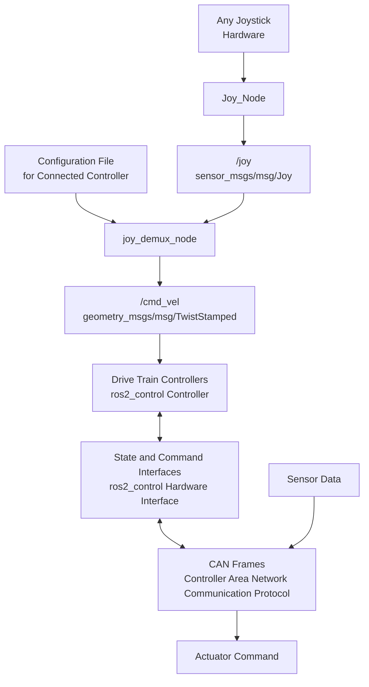

# SCRB-MF-27-06-1-S-Ros2-Swerve-Controller
Repository for the development of the drive train ROS2 control controller. This includes the custom swerve drive, Ackermann and differential drive controllers.

## Current Goal:
Currently we are implementing a Swerve Drive (specifically Four-Wheel Independent Steering / 4WIS). 
The current tasks can be found in [TODO.md](swerve-drive/TODO.md)

## Overal Project Structure

## Extra controllers to implement in the future:

### All ready existing controllers to implement:
- Differential Drive Controller
- Ackermann Steering Controller

### Custom controllers to implement:
- Double Ackermann Steering Controller